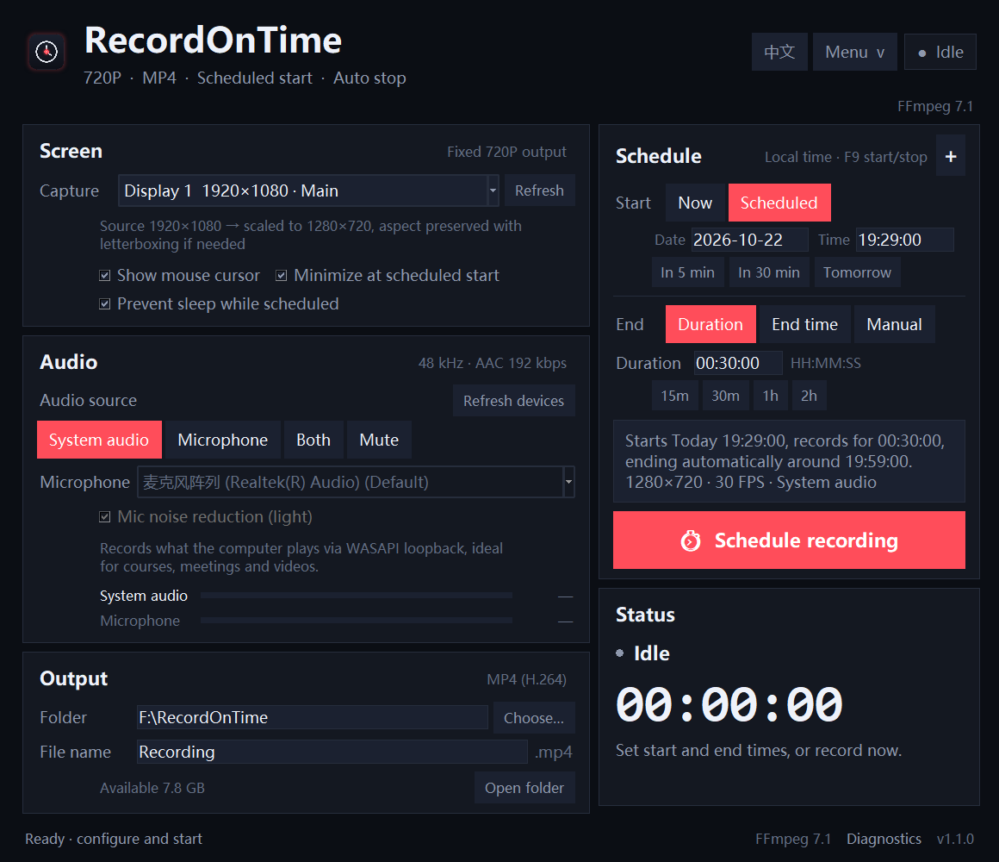

# RecordOnTime

A 720P Windows screen recorder with **scheduled start**, **scheduled stop**, **pause/resume**, and **automatic follow-up rounds**. The interface is bilingual and starts in **English**; click **中文** in the top-right corner to switch to Chinese.



中文界面：[screenshots/ui_zh.png](screenshots/ui_zh.png)

**Download:** [RecordOnTime_v1.1.7_win64.zip](dist/RecordOnTime_v1.1.7_win64.zip) (local build)

## Highlights

- **Bilingual UI** — English by default, one-click switch to Chinese. The choice is remembered.
- **Exact scheduling** — start at a date/time and end after a duration, at a fixed time, or manually.
- **Pause / resume** — F10 or the Pause button. Paused time is removed from the video; resumed parts are joined into one MP4 automatically.
- **Next rounds (+) queue** — click **+** in the Schedule card header to queue another automatic start/end round. When the current recording ends, the next round is armed and starts by itself. Multiple rounds can be queued; the queue is saved between sessions.
- **720P MP4** — 1280×720, 30 FPS, H.264 High Profile, AAC 192 kbps, standard MP4.
- **Clear audio** — WASAPI loopback for system sound, optional microphone, 48 kHz, high-pass, dynamic leveling and limiting. A silent keep-alive stream prevents WASAPI loopback from stalling when nothing is playing.
- **Contact / Donate menu** — top-right **Menu**: author email `linan138@gmail.com`, plus the Alipay donation QR code.
- **Windows 10/11 64-bit**, local only, no telemetry.

## Quick start

1. Download [RecordOnTime_v1.1.7_win64.zip](dist/RecordOnTime_v1.1.7_win64.zip) and extract the whole folder.
2. Run `RecordOnTime.exe`.
3. Choose a display, audio source and output folder.
4. Pick **Now** or **Scheduled**, set **Duration / End time / Manual**, then click the red button.

> The EXE needs the `_internal` folder next to it. Do not copy the EXE alone. If SmartScreen shows “Unknown publisher”, choose **More info → Run anyway**.

No Python, FFmpeg or PyAudio installation is required in the packaged build.

## Using the scheduler

### One round

- **Start**: `Now` or `Scheduled` with a date (`YYYY-MM-DD`) and time (`HH:MM:SS`). Quick buttons: in 5 min, in 30 min, tomorrow.
- **End**:
  - `Duration` — e.g. `00:30:00`, counted from the actual start;
  - `End time` — an absolute date/time;
  - `Manual` — stop with the button or F9.
- Click **Schedule recording**. The status card shows the countdown and end time.
- Keep the app running. It can be minimized; it must not be closed. While waiting/recording, RecordOnTime asks Windows to stay awake and keep the display on (can be disabled in the Screen card).

Actual capture usually begins 0.2–2 seconds after the trigger because audio devices and FFmpeg must start; the stop time remains the configured absolute time.

### Change the end mode while recording

Click **End mode…** in the status card during recording or pause:

- choose **Use manual end** to remove the automatic stop;
- or enter a date/time and choose **Set automatic end** to add/replace the stop time.

The watchdog reads the new value immediately; no restart is needed. If the new time is already due, recording stops immediately.

### Pause / resume

- While recording, click **Pause** or press **F10**.
- While paused, the timer freezes and the button changes to **Resume**. Click it or press F10 to continue.
- Pause creates a new capture segment. At stop time all segments are muxed to one MP4; paused periods are not included.
- Auto-stop still works while paused: when the scheduled end time arrives, the recording is saved immediately.

### Next rounds with `+`

1. Click **+** at the right of the **Schedule** card header.
2. Enter the next round’s automatic start and end date/time and click **Add**.
3. The queue summary appears in the preview box, e.g. `Next: 21:00:00–21:30:00 (+1)`.
4. When the current task finishes, the next queued task is scheduled automatically. If its start time already passed but its end time is still in the future, it starts immediately; otherwise it is skipped.

**`+` only appends a task; it never replaces or cancels task #1.** If task #1 is still in the form, adding a next round first arms that existing task, then appends the new round to the queue. If the form is invalid, the new round waits in the queue until you complete and schedule task #1. The queue can contain multiple rounds, is validated against the first task and each previous queued round, and is stored in settings.

The `+` button remains available while recording or paused.

## Menu

Top-right **Menu**:

- **Contact author** — displays `linan138@gmail.com`; copy it or open your mail client.
- **Donate** — displays the Alipay QR code from `assets/alipay_2.png`.

## Output

| Item | Value |
|---|---|
| Container | MP4 (standard, no faststart — finalizes much faster) |
| Video | H.264 High Profile, 1280×720, 30 FPS; Desktop Duplication + QSV (fallbacks: gdigrab/QSV, x264 ultrafast) |
| Audio | AAC-LC 48 kHz stereo 192 kbps (Windows Media Foundation encoder, native fallback) |
| Aspect ratio | Preserved, letterboxed to exactly 1280×720 |
| Temporary format | MKV segments while recording; MP4 when finished |

Recordings go to the selected folder (default `%USERPROFILE%\Videos\RecordOnTime`). The file name uses the prefix and the session start time, e.g. `Recording_2026-10-22_19-30-00.mp4`.

### Recording CPU

The old encoder was libx264 `veryfast` (CRF 19) and could exceed 20–25% CPU. v1.1.7 records single-audio-source sessions directly to MP4 with **Media Foundation H.264 (`h264_mf`) + gdigrab**:

- measured recording CPU on this machine: about **9%**, down from 20–25%;
- output is 1280×720 H.264 at 30 FPS;
- no audio or system+microphone recordings still use the MKV path with Desktop Duplication/QSV (about 1–2%), but need post-processing;
- Desktop Duplication cannot be combined with the live PCM input used by the direct-MP4 path on this driver (QSV surface allocation failure), so it is not used there.

### Saving speed

The direct-MP4 path needs **no post-recording mux**: FFmpeg writes the final MP4 while recording, so stopping only finalises the MP4 index and renames the file. Measured **0.4–0.6 seconds** after stop, including probing and cleanup. This applies to uninterrupted single-audio recordings, including 2-hour files.

For the fallback MKV path (system + microphone, or direct capture unavailable), v1.1.7 still uses parallel AAC chunks:

- audio uses **Windows Media Foundation AAC (`aac_mf`)** (native AAC with `-aac_coder fast` as fallback);
- for single-track recordings of **1 hour or longer**, up to four audio chunks are encoded in parallel and concatenated with `-c:a copy`;
- a 2-hour synthetic non-silent test completed in about 40 seconds.

Pause/resume uses multiple segments. Paused recordings still need a final concat and may exceed 2 seconds; uninterrupted recordings use the direct path.

## How it works

- Python 3.11 + Tkinter UI.
- Single-audio recordings use `h264_mf` + gdigrab and write MP4 directly; no-audio / system+mic recordings use `ddagrab`+QSV MKV with `gdigrab`/x264 fallbacks, 720P.
- PyAudioWPatch / PortAudio WASAPI loopback for system sound, plus optional microphone. A callback stream feeds live 48 kHz PCM to the direct MP4 encoder; the MKV path writes WAV segments.
- Pause/resume creates numbered segments. Direct-MP4 segments are concatenated only if pause was used; uninterrupted recordings are finalized in place.
- An independent watchdog thread enforces `stop_at`, so auto-stop works even if the UI is briefly busy. The end mode can be changed live between automatic and manual.
- `SetThreadExecutionState` prevents sleep; a named mutex enforces a single instance.

## Files and settings

| Content | Path |
|---|---|
| Settings | `%APPDATA%\RecordOnTime\settings.json` |
| Logs | `%APPDATA%\RecordOnTime\logs\app.log` |
| Temporary segments | `<output folder>\.RecordOnTime_tmp\` (same volume as the final MP4) |
| Default output | `%USERPROFILE%\Videos\RecordOnTime\` |

Temporary capture files are written to the output folder so the finished MP4 does not have to be copied across drives. If that folder is not writable, the app falls back to `%LOCALAPPDATA%\RecordOnTime\work\` and shows a warning.

Portable mode: create an empty `portable.flag` next to the EXE to keep settings, logs and temporary files under `userdata\`.

## Build from source

Requirements: Windows 10/11, Python 3.11–3.14.

```powershell
python -m venv .venv
.\.venv\Scripts\python.exe -m pip install -r requirements-dev.txt
powershell -ExecutionPolicy Bypass -File .\build.ps1
```

Output:

- `dist\RecordOnTime\RecordOnTime.exe`
- `dist\RecordOnTime_v1.1.7_win64.zip`

The PyInstaller spec is `RecordOnTime.spec`; FFmpeg is bundled as `vendor\ffmpeg.exe` (not embedded into the EXE) for fast startup. The binary is not committed to Git; `build.ps1` fetches it via `imageio-ffmpeg`, and the release ZIP includes it.

Run from source (place `vendor\ffmpeg.exe` first, or run the build once to fetch it):

```powershell
.\.venv\Scripts\python.exe app.py
```

or double-click `Start_RecordOnTime.bat`.

## Tests

```powershell
.\.venv\Scripts\python.exe -m unittest discover -s tests -p "test_*.py"
```

The suite covers time parsing, settings, FFmpeg command construction, two-track audio muxing, video-only output and MP4 validation. Manual checks:

```powershell
.\.venv\Scripts\python.exe app.py --diagnose
.\.venv\Scripts\python.exe app.py --smoke-test 3 --output-dir .\smoke_output
```

## Notes / troubleshooting

- **Scheduling requires the app to keep running.** It is a local timer, not a Windows scheduled task.
- **Keep the computer awake.** The option is enabled by default; unchecking it may cause a missed/late start.
- Locking the screen can produce a black recording; DRM/protected video and WASAPI-exclusive players may also be black/silent.
- If system audio is missing, confirm the default playback device and disable exclusive mode in the player.
- If microphone audio is missing, check Windows microphone privacy settings and refresh the device list.
- A failed finalization leaves the MKV/WAV segments in `<output folder>\.RecordOnTime_tmp\` (or `%LOCALAPPDATA%\RecordOnTime\work\` if the output folder was not writable); they can be muxed manually with FFmpeg.
- The app is completely local and does not upload anything.

## License

- Application code: MIT (`LICENSE`).
- Bundled FFmpeg 7.1 essentials build: GPLv3 (includes libx264), see `vendor/FFMPEG_NOTICE.txt`.
- PyAudioWPatch / PortAudio / NumPy retain their own licenses.

---

## 中文简介

RecordOnTime 是一个 720P Windows 录屏工具，默认英文界面，右上角可切换中文。

- 定时开始、按时长/指定时间/手动结束
- **暂停/继续**（F10），暂停时间不会进入视频，恢复后自动拼接为一个 MP4
- **+ 号添加下一轮**，自动接续下一段的开始/结束时间，可排队多轮；`+` 只追加任务，不会覆盖或取消第一轮任务。若第一轮仍在表单中，点 `+` 会先安排该任务，再把新一轮加入队列；若第一轮表单无效，队列会等待你补全并安排第一轮。
- 右上角 **Menu**：联系作者 `linan138@gmail.com`、支付宝捐赠二维码
- 系统声音（WASAPI 回环）+ 麦克风，48 kHz AAC 192 kbps
- 输出 1280×720、30 FPS、H.264 MP4

解压 zip 后整体运行，不要只复制 EXE。定时任务要求程序保持运行（可最小化），默认会阻止系统休眠。详细说明见上方英文部分。
